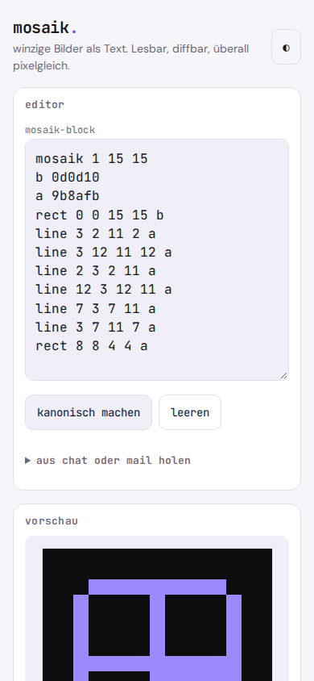
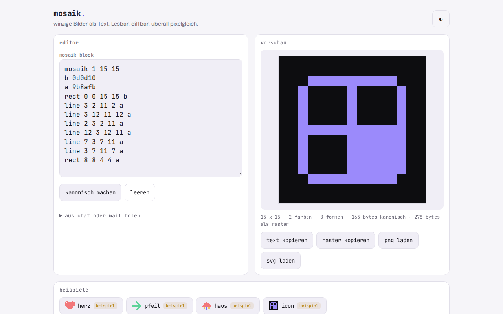

# mosaik.

**A picture that fits through any text channel.** mosaik. is a small, strict text format for tiny images (icons, pixel art, status marks) that gives the same pixels everywhere. It comes with a spec, a dependency-free JavaScript reference implementation, test vectors and an offline demo page you can install as a PWA.

   

**Try it:** https://gedachtgemacht.github.io/mosaik/ (works in any phone browser, install via "Add to Home Screen")

The demo page interface is in German. The format, the spec keywords and the error codes are plain ASCII.

Icons, pixel images and status marks are hard to carry as text. Base64 PNG is unreadable and cannot be diffed. SVG is readable, but it can contain scripts and references and looks different depending on the program. mosaik. has a palette, a grid and two shapes (rectangle, line), fixed limits and a rasterization rule written out word for word. The format is a specification with a reference implementation, test vectors and a demo page.

```
mosaik 1 3 2
a ff0000
b 0000ff
rows
ab.
.ba
```

Plain text, no AI, no server. Everything stays on your device.

<p align="center">
  
</p>
<p align="center">
  
</p>

## Why

People and language models write text all the time that really means a picture. What is missing is a format that is readable, diffs cleanly in Git, has no active content and looks pixel-identical in every viewer. Related approaches exist: XPM is tied to C source and X11, plain PBM/PPM are columns of numbers without a palette. What is new is the combination, not each single idea.

## Features

- **Specification** `SPEC.md` for `mosaik 1`: grammar, limits, rasterization rule, error codes with line number
- **Reference implementation** `mosaik.js`, an ES module with no dependencies for browser and Node: `parse`, `extract`, `render`, `canonical`, `flatten`, `toSVG`
- **Test vectors** in `vectors/` and collected in `testvektoren.json`, worked out by hand
- **Demo page** with editor, live preview, error display with code and line, examples and a quick reference
- **Paste** whole chat or mail texts: `extract` finds the first block, also inside code fences and quotes
- **Canonical form** for clean diffs and a **flat form** that resolves shapes into a grid
- **Export** as text, as grid, as PNG and as SVG, all local
- **Examples** (herz, pfeil, haus, icon: heart, arrow, house, icon), marked as **Beispiel** ("example") and removable with one click
- Light and dark, works offline, installable as an app

## Privacy

Nothing leaves your device. The demo page has no server, no account, no analytics, no ads and loads nothing from the network, not even fonts. What you type into the editor stays in the browser. Exports only happen when you trigger them.

## Install

The demo page is a static web app. There is no build step and there are no dependencies.

1. Put the folder on any static host. Installing as an app needs HTTPS.
2. Open the address in the browser.
3. In the browser menu choose **Add to Home Screen**. After that mosaik. starts like an app and also works without a network.

Test locally:

```
python3 -m http.server 8000
```

Then open `http://localhost:8000`. `index.html` contains an embedded copy of `mosaik.js` and also runs straight from the file. After changes to `mosaik.js`, `node einbetten.js` copies it back in.

As a library:

```js
import { extract, parse, render, toSVG } from './mosaik.js';

const text = extract(chatText);   // erster Block oder null
const bild = parse(text);          // Bild oder Fehler mit Code und Zeile
```

The exact return shapes are in `SPEC.md` and `mosaik.js`.

## How it works

The full description is in [`SPEC.md`](SPEC.md). In short:

- A block consists of the header line `mosaik 1 <breite> <hoehe>` (width, height), a palette (up to 62 opaque colors as `rrggbb`), the commands `rect`, `line` and `rows`, and comments. Later commands paint over earlier ones.
- Size 1 to 64 by 1 to 64, at most 256 commands, at most 8192 bytes, printable ASCII only.
- Lines use integer Bresenham, written out word for word in the spec. Swapped endpoints can give different pixels, so an implementation must not normalize them.
- No antialiasing, no alpha except fully transparent.
- The parser stops at the first error and names code and line, for example `E_UNKNOWN_KEY` in line 4.

Tested with `node test-calc.js` (vectors, properties such as an idempotent canonical form, limits, error cases, SVG without scripts and references) and with `test-browser.py` for the demo page.

**Known:** the rasterization rule, the error codes and the canonical form are fixed and covered by vectors.

**Assumption, still open:**

- Whether shapes really save text. For the demo page icon yes (165 against 278 bytes), for the heart no.
- Whether a code fence with the language tag `mosaik` is recognized usefully in chats and forums. A chat shows the block only as text anyway, the picture only appears in the viewer.
- Whether 64 by 64 and 62 colors are the right limits.
- Whether semi-transparent colors will be needed in a version 2.

## License

GNU Affero General Public License v3.0 (AGPL-3.0), see `LICENSE`.

**Deutsch:** mosaik. ist ein lesbares Textformat für winzige Bilder und Pixelgrafiken mit Palette, Raster und einfachen Formen, mit Spezifikation, JavaScript-Referenzimplementierung, Testvektoren und Offline-Demoseite.

---

**gedacht.gemacht.** Small, honest software. Everything stays on your device. · [More projects](https://github.com/gedachtgemacht)
